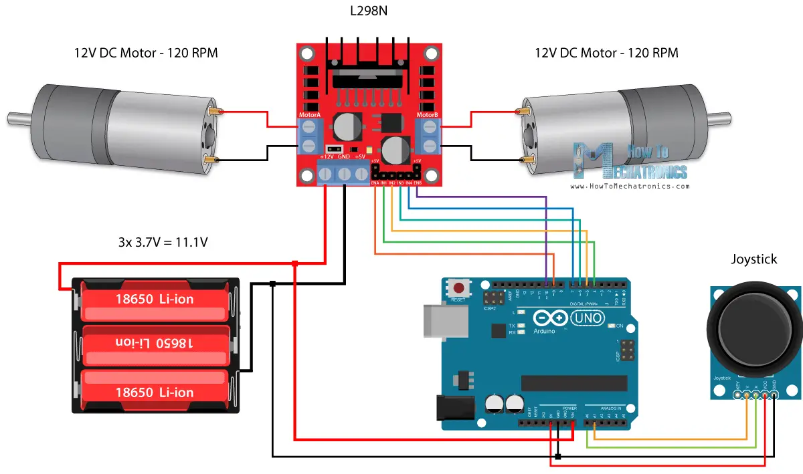

## Сравнение контроллеров

### 📊 Итоговая таблица: I/O, программирование и прямое подключение

| Контроллер | Логика | Цифровые I/O (GPIO) | Аналоговые входы (ADC) | Аппаратный ШИМ | Ключевые интерфейсы | Языки программирования | Прямое подключение к энкодеру JGB37-520 | Прямое подключение к L298N |
| :--- | :--- | :--- | :--- | :--- | :--- | :--- | :--- | :--- |
| **ESP32 (DevKit)** | 3.3 В | ~34–36 | до 18, 12 бит | 16 каналов | 3×UART, 4×SPI, 2×I2C | C/C++ (Arduino, ESP-IDF), MicroPython | ✅ Да, при питании энкодера от **3.3 В** | ✅ Да |
| **NodeMCU (ESP8266)** | 3.3 В | 11 | 1, 10 бит | 4 канала | 2×UART, 1×SPI, 1×I2C | C/C++ (Arduino), Lua, MicroPython | ✅ Да, при питании энкодера от **3.3 В** | ✅ Да |
| **Arduino Nano** | 5 В | 14 | 8, 10 бит | 6 каналов | 1×UART, 1×SPI, 1×I2C | C/C++ (Arduino) | ✅ Да, при питании энкодера **3.3 В или 5 В** | ✅ Да |
| **Raspberry Pi Pico** | 3.3 В | 26 | 3, 12 бит | 16 каналов | 2×UART, 2×SPI, 2×I2C | MicroPython, C/C++ (SDK) | ✅ Да, при питании энкодера от **3.3 В** | ✅ Да |
| **Bluepill (STM32F103C8T6)** | 3.3 В | ~37 | 10, 12 бит | 15 каналов | 3×UART, 2×SPI, 2×I2C, **1×CAN** | C/C++ (Arduino, STM32Cube) | ✅ Да, при питании энкодера от **3.3 В** | ✅ Да |

### ⚡ Производительность и стоимость

| Контроллер | Тактовая частота (макс.) | CoreMark (≈) | Относительная производительность (к Arduino Nano) | Ориентировочная цена (РФ), ₽ |
| :--- | :--- | :--- | :--- | :--- |
| **Arduino Nano (ATmega328P)** | 16 МГц | **~28** | **1x** (базовая точка) | ~249–532 |
| **Bluepill (STM32F103C8T6)** | 72 МГц | **~140** | **~5x** | ~284–490 |
| **NodeMCU (ESP8266)** | 80–160 МГц | **~191** (при 80 МГц) | **~6.8x** | ~214–599 |
| **Raspberry Pi Pico (RP2040)** | 133 МГц (2 ядра) | **~321** (на ядро, 133 МГц) | **~11.5x** (на ядро) | ~350–400 / $4 |
| **ESP32 (DevKit)** | 240 МГц (2 ядра) | **~660** (1 ядро, 160 МГц) / **~999** (2 ядра, 240 МГц) | **~23.6x** (1 ядро) — **~35.7x** (2 ядра) | ~685–756 |


### 💡 Что важно знать о коэффициенте производительности

*   **CoreMark — это синтетика.** Он хорошо показывает «грубую» вычислительную мощность, но не учитывает наличие аппаратного FPU (блока для чисел с плавающей точкой), эффективность прерываний или скорость работы с периферией. Например, для задач с интенсивной математикой с плавающей точкой разрыв между 8-битным AVR и 32-битными ядрами будет ещё больше, чем показывает CoreMark.
*   **Многопоточность даёт больше, чем показывает один CoreMark.** ESP32 и RP2040 — двухъядерные. В реальных задачах (например, одновременное чтение энкодера и генерация ШИМ для моторов) это даёт существенный выигрыш по сравнению с однопоточным выполнением, который не отражается в одном числе CoreMark на ядро.
*   **Arduino Nano остаётся самым слабым звеном по производительности.** Его 28 CoreMark более чем достаточно для простого управления моторами и чтения энкодера в реальном времени, но для сложной обработки сигналов, компьютерного зрения или одновременной работы с Wi-Fi и множеством датчиков его мощности может не хватить.


## API

| КОМАНДА         | ОПИСАНИЕ                                                                                                                |
|-----------------|-------------------------------------------------------------------------------------------------------------------------|
| `set_speed v ω` | Ехать: линейная скорость v (мм/с), угловая ω (рад/с, + = против часовой).<br>Внутри — кинематика и PID на каждое колесо |
| `stop`          | Стоп: отключить драйвер, свободный выбег колёс                                                                          |
| `power_stop`    | Экстренное торможение: L298N fast stop, 300 мс, затем выбег                                                             |

## Прошивка

1. Отключить HC-06 от D0/D1 — загрузчик использует аппаратный UART.
2. Подключить Arduino Nano по USB.
3. Собрать и залить прошивку: кнопка **Upload** в PlatformIO IDE или
   `~/.platformio/penv/bin/pio run -t upload`.
4. Подключить HC-06 обратно.
5. Первый запуск после прошивки выполнить до подключения ПК по Bluetooth:
   прошивка переведёт HC-06 на 115200.

## Управление через bluetooth

Используемый модуль: HC-06

### Подключение электрическое

| Провод       | Направление | Куда идёт           |
|--------------|-------------|---------------------|
| Arduino D1   | →           | Level shifter HV1   |
| Arduino D0   | ←           | Level shifter HV2   |
| Arduino 5V   | →           | Level shifter VCC_HV|
| Arduino 3.3V | →           | Level shifter VCC_LV|
| Arduino GND  | →           | Level shifter GND   |
| Arduino GND  | →           | HC-06 GND           |
| Level LV1    | →           | HC-06 RXD           |
| Level LV2    | ←           | HC-06 TXD           |
| 5V (Cedar)   | →           | HC-06 VCC           |
| GND (Cedar)  | →           | HC-06 GND           |


| PIN   | ФУНКЦИЯ                  | НАПРАВЛ. | УСТРОЙСТВО                       |
|-------|--------------------------|----------|----------------------------------|
| D0    | Serial RX (HW)           | IN ◀     | HC-06 TXD (через level shifter)  |
| D1    | Serial TX (HW)           | OUT ▶    | HC-06 RXD (через level shifter)  |
| D2    | Motor dir A (Right)      | OUT ▶    | L298N IN1                        |
| D3    | Motor dir B (Right)      | OUT ▶    | L298N IN2                        |
| D4    | Motor dir A (Left)       | OUT ▶    | L298N IN3                        |
| D5    | Motor speed (Right PWM)  | OUT ▶    | L298N ENA                        |
| D6    | Motor speed (Left PWM)   | OUT ▶    | L298N ENB                        |
| D7    | Motor dir B (Left)       | OUT ▶    | L298N IN4                        |
| D8    | FREE                     | —        |                                  |
| D9    | FREE                     | —        |                                  |
| D10   | FREE                     | —        |                                  |
| D11   | FREE                     | —        |                                  |
| A0    | Encoder Right A          | IN ◀     | JGB37-520 Right                  |
| A1    | Encoder Right B          | IN ◀     | JGB37-520 Right                  |
| A2    | Encoder Left A           | IN ◀     | JGB37-520 Left                   |
| A3    | Encoder Left B           | IN ◀     | JGB37-520 Left                   |
| A4/A5 | I2C (SDA/SCL)            | —        | (не используется)                |
| A6/A7 | FREE (ADC only)          | —        |                                  |
| 5V    | Питание level shifter HV | POWER    | Level shifter                    |
| 3.3V  | Питание level shifter LV | POWER    | Level shifter                    |
| GND   | Общая земля              | POWER    | ВСЕ устройства                   |

D0/D1 — аппаратный UART. При прошивке по USB HC-06 нужно отключить:
загрузчик использует те же линии. SoftwareSerial не используется, потому что
его PCINT-алиасы конфликтуют с ISR энкодеров.

Рабочая скорость UART — **115200**. HC-06 хранит скорость между включениями,
поэтому прошивка при старте сама переводит модуль на 115200 (`AT+BAUD8`,
при отказе — `AT+UART=115200,0,0`). AT-команды принимаются только пока к
модулю не подключён ПК.

### Подключение на PC

```shell
bluetoothctl devices

Device 00:21:13:00:0C:E3 HC-06
```
PIN 1234
```shell
bluetoothctl pair 00:21:13:00:0C:E3
Attempting to pair with 00:21:13:00:0C:E3
[CHG] Device 00:21:13:00:0C:E3 Connected: yes
[CHG] Device 00:21:13:00:0C:E3 RSSI is nil
[CHG] Device 00:C3:F4:06:6A:F3 RSSI is nil
[CHG] Controller C4:85:08:AD:5A:56 Discovering: no
[CHG] Device 00:21:13:00:0C:E3 Bonded: yes
[CHG] Device 00:21:13:00:0C:E3 UUIDs: 00001101-0000-1000-8000-00805f9b34fb
[CHG] Device 00:21:13:00:0C:E3 ServicesResolved: yes
[CHG] Device 00:21:13:00:0C:E3 Paired: yes
Pairing successful
```
```shell
sudo rfcomm bind rfcomm0 00:21:13:00:0C:E3 1
```

Светодиод будет мигать часто до подключения к терминалу.

Не нужно использовать bluetoothctl connect - всегда будет ошибка

/dev/rfcomm0 — это виртуальный файл устройства в Linux, который представляет собой 
последовательный порт (UART), перенаправленный через Bluetooth.Когда вы привязываете модуль HC-06 командой rfcomm bind,
Linux создает этот файл в каталоге /dev/ (от слова devices). 

Для операционной системы и любых программ работа с HC-06
через этот файл выглядит абсолютно так же, как работа с обычной флешкой-программатором, COM-портом или USB-кабелем 
Arduino (/dev/ttyUSB0). Когда вы записываете данные в /dev/rfcomm0, Linux передает их по радиоканалу Bluetooth на HC-06. 
Когда Arduino отправляет данные в свой TX-пин, они летят по воздуху и появляются в файле /dev/rfcomm0.

```shell
cat /dev/rfcomm0

```
Или

```shell
picocom -b 115200 /dev/rfcomm0
```

После подключения светодиод перестает мигать часто и в консоли появляется сообщения.
Если просто выйти из консоли, то порт будет занят. Нужно убить процесс picocom.

```shell
sudo lsof /dev/rfcomm0

```

## Телеметрия

Бот отвечает на каждую команду `set_speed` строкой `ack` (раз в ~200 мс):

```
ack <n> <v> <w> mL=<mL> mR=<mR> oL=<oL> oR=<oR> iL=<iL> iR=<iR>
```

### Метрики

| Поле    | Описание                                            | Единицы   | Диапазон / примечание |
|---------|-----------------------------------------------------|-----------|-----------------------------------------------------------|
| `n`     | Счётчик команд на стороне бота                      | шт.       | Инкремент на каждый `set_speed`; счёт живёт с момента прошивки, перезапуск пульта его не сбрасывает |
| `v`     | Уставка линейной скорости                           | мм/с      | ±300 (`V_MAX_MM_S`) |
| `w`     | Уставка угловой скорости                            | рад/с     | ±ω_max ≈ 3.24 (`2·300 / WHEELBASE`, WHEELBASE = 185 мм) |
| `mL`    | Измеренная скорость левого колеса                   | мм/с      | Квант 8.54 мм/с (1 тик энкодера за 10 мс); обновляется только в состоянии RUN |
| `mR`    | Измеренная скорость правого колеса                  | мм/с      | То же, что и `mL` |
| `oL`    | ШИМ левого колеса (выход PID)                       | ШИМ       | ±255 (значение ШИМ motor speed) |
| `oR`    | ШИМ правого колеса (выход PID)                      | ШИМ       | ±255 |
| `iL`    | Интегральная составляющая PID левого колеса         | усл.      | Кламп ±500 (`PID_INTEGRAL_LIMIT`) |
| `iR`    | Интегральная составляющая PID правого колеса        | усл.      | ±500 |

Те же сокращения выводятся двумя строками прямо над заголовком таблицы телеметрии в консольном пульте.

### Особенности

* На стопе (`stop`/`power_stop`) измеренная скорость замирает: энкодеры не читаются вне состояния RUN, поэтому `mL/mR` могут показывать последнее значение перед остановкой, а не ноль.
* В консольном пульте (`pc_control/controller.py`) последние 50 строк `ack` выводятся в панель телеметрии (свежие сверху, свежайшая строка подсвечена).


## Черновик

### Сделать запись в файл полного лога с телеметрией для сеанса работы в консоли управления





